<p align="center">
  <picture>
    <source media="(prefers-color-scheme: dark)" srcset="docs/images/logo_dark.png">
    
  </picture>
</p>

<p align="center">
  
  
  
  
  <a href="https://doi.org/10.5281/zenodo.23120194"></a>
  
  <a href="#documentation"></a>
</p>

<p align="center">
  <b>MPSim (Material Property Simulation)</b> computes the effective properties of semiconductor materials
  from their microstructure, in a browser workspace.
</p>

<p align="center">
  <a href="https://hyoseokbyun-opt.github.io/MPSim/">Website</a> ·
  <a href="#software-description">Description</a> ·
  <a href="#analyses">Analyses</a> ·
  <a href="#application-example-a-mould-underfill-from-flow-to-cure">Example</a> ·
  <a href="#verification">Verification</a> ·
  <a href="#installation">Installation</a> ·
  <a href="https://github.com/HyoseokByun-opt/MPSim/releases/latest/download/MPSim-User-Guide-EN.pdf">User guide</a> ·
  <a href="#citing">Citing</a>
</p>

<p align="center">
  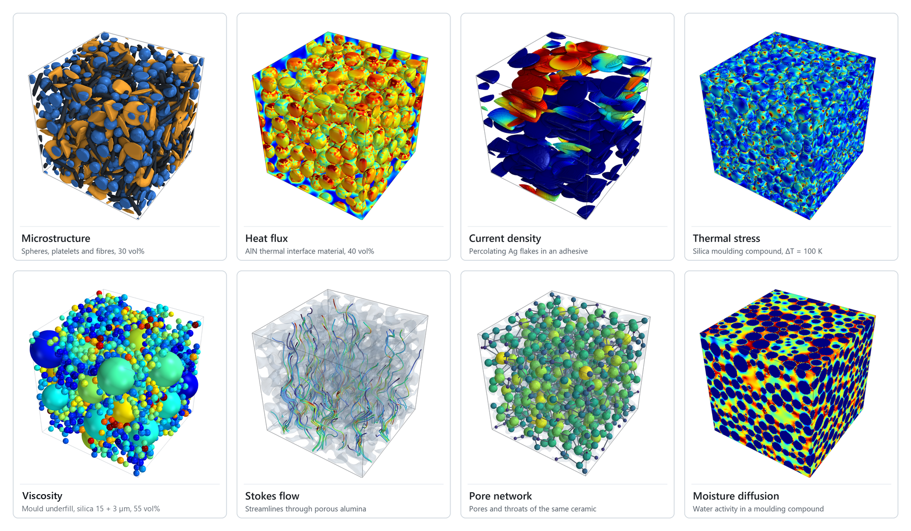
</p>

## Software description

MPSim (Material Property Simulation) has been developed to compute effective material properties and to perform
material response simulations on digital microstructures of composite and porous materials. MPSim generates
artificial microstructures on a voxel representative volume element (RVE), with fillers of arbitrary shape, size
distribution and orientation, pores, coatings and thin films, and solves the governing equations on the RVE with
validated open-source solvers. The results comprise the effective property tensors, the local fields (temperature,
heat flux, electric field, stress, water activity, flow velocity) and a set of checks on the representativeness of the
RVE.

The software targets the materials of semiconductor packaging, devices and process equipment: moulding compounds,
underfills, thermal interface materials, conductive adhesives, low-k and high-k dielectrics, EMI absorbers, porous
ceramics and filters. The workflow is carried out in a single browser workspace: material definition, microstructure
generation, voxel grid, RVE checks, solution, and the evaluation of fields, charts and reports. MPSim runs on a single
PC or on a server that is accessed from other computers on the network; data do not leave the machine.

The main capabilities are listed below.

- **Microstructure generation.** Spheres, spheroids (needles and platelets), cylinders, capsules, cubes, cuboids,
  superellipsoids, polyhedra (irregular grains, each with a shape of its own if wanted), helices and connected networks with full 3D
  rotation; normal and log-normal size distributions with bounds, or a measured particle-size distribution loaded from
  the analyser's file (by volume or by number); coated and hollow particles, several filler phases in one RVE, pores as
  a material phase and gas matrices. Dense packings are obtained by rigid-clump relaxation and Monte-Carlo compression,
  and every blend that packs is checked so that no voxel belongs to two particles. Particles may touch, as in a filled compound
  (the default), or are kept a set number of voxels apart. A loading that cannot be packed without overlap (equal spheres
  beyond random close packing, dense cubes) is reached with the least overlap it takes, 1 voxel and then 2, rather than
  with every particle drawn smaller (spheres at 66 vol%: 65.95 % instead of 62.6 %). Sphere packings can be sheared in the resin by
  particle dynamics before they are drawn, which yields the arrangement of a compound after flow. Fillers and further
  matrix materials can be confined to sections (slabs) of the RVE, so that two compounds, a filled layer on an unfilled
  one or a resin interlayer are modelled as one structure.
- **Compression while the resin flows.** The periodic RVE is shortened along z with its sides free or held, step by
  step: each step solves the three-dimensional creeping flow of the whole RVE on its voxels (every resin with its own
  viscosity, the filler spheres rigid, the pores a compressible gas), the spheres move as rigid bodies and the resins
  and pores as material markers that keep the volume of an incompressible resin. The result is the compressed box,
  solved by every analysis, with the strain and von Mises stress of each region, how far the pores close and whether
  particles pass into another resin; the whole box of every step is kept and played step by step in 3D. The resins can cure meanwhile: Kamal–Sourour kinetics,
  the Castro–Macosko viscosity rise to the gel point and a lumped energy balance with the mould, closing at a set strain
  rate or no faster than a set axial stress.
- **Coupled analyses of a thin film.** Thermal stress and warpage: the steady temperature field of the heat flowing
  through the film, every voxel's thermal strain at its own temperature (α1 or α2 and the glassy or rubbery modulus by
  its Tg), and classical laminate theory for the curvature of the film free, on a substrate or held flat. Joule heating:
  the potential with every voxel's conductivity at its temperature, the heat of the current split exactly between voxels,
  and the temperature, solved in turn to a steady state at each step of a current or voltage sweep, up to thermal
  runaway.
- **Uneven dispersions.** The same recipe can be arranged unevenly to compare with the even dispersion: particles only
  in a region of the box, a loading graded along an axis, or a share of the particles gathered in clusters. The
  packing follows the requested density by Monte-Carlo moves weighted against the crowding of hard spheres, and the
  arrangement realised is measured and reported.
- **RVE sizing.** The RVE edge is 7 times (Standard) or 10 times (Accurate) the largest particle, a criterion determined
  with the statistical method of Kanit et al. (2003). The volume-fraction error, octant homogeneity, directional scatter
  and convergence are checked on every run; several realisations provide a 95 % confidence interval. An RVE too large
  to solve can be replaced by small ones solved again with new arrangements until the 95 % interval of every mean is
  within a target (a statistical RVE after the same paper), and the random seed is a DOE factor.
- **Thin films.** Periodic in x and y, with the real film thickness in z and every particle inside the film.
- **Conduction.** Thermal, electrical, dielectric and magnetic conduction with a periodic finite-volume solver
  (multi-core, FFT-preconditioned; its operator is NASA PuMA's finite-volume operator, with periodic instead of fixed
  faces) and, alternatively, the finite elements of NASA PuMA. Interfacial thermal resistance
  between filler and matrix and at filler-filler contacts is applied on the voxel faces. Anisotropic fillers (for
  example h-BN platelets) carry their conductivity tensor rotated with each particle.
- **Mechanics.** Stiffness, engineering constants and the thermal-expansion tensor from FANS, the periodic voxel finite
  elements of NASA PuMA solved with an FFT preconditioner whose iteration count does not grow with the grid (seven load
  cases on 96³ voxels in 49 s, 11 times faster than MINRES on the same discretisation), optionally above the glass
  transition. A mechanical test in tension or compression, controlled by displacement, strain, force or pressure on a
  specimen of given length and area, with free or confined sides, gives the force-displacement line, the apparent
  modulus and Poisson's ratio, the stress and strain fields in the RVE and the load at which the matrix reaches its
  strength.
- **Rheology.** Effective viscosity of underfills, moulding compounds and pastes from a creeping-flow solution on the RVE
  and, for dense fillers of any shape, from particle dynamics in which every filler translates, rotates and collides in
  the sheared resin (lubrication, friction, van der Waals attraction; cubes, platelets and rods as rigid clumps of
  spheres; NVIDIA GPU or CPU). The particle dynamics also provides the particle-size effect and the shear thinning
  caused by attraction. Krieger-Dougherty with the maximum packing fraction of the actual size distribution, flow
  curves, capillary underfill filling time and filler settling complete the analysis.
- **Moisture.** Effective moisture diffusivity (solved on the water activity), saturated uptake, the uptake curve of a
  part and hygroscopic swelling.
- **Electromagnetic shielding.** Frequency-resolved complex homogenisation coupled with a transmission-line model, and a
  full-wave simulation of the RVE slab in openEMS (FDTD, voxel by voxel) that is run by default to verify the
  homogenisation.
- **Porous media.** Permeability (Stokes flow), filtration efficiency by particle tracking, diffusion and tortuosity,
  acoustic absorption (Johnson-Champoux-Allard), radiative extinction, porosimetry, pore networks, percolation paths
  and grain statistics.
- **Calibration.** Unknown material values (interfacial and contact resistance, the conductivity of a filler grade, the
  bound resin layer or the adhesion of a filler surface) are determined from measured effective properties, including
  viscosity: the acoustic and diffuse mismatch models as a starting point, an identifiability check, a Bayesian calibration
  on an RVE or particle-dynamics surrogate with credible intervals, and the next measurement that adds the most
  information. Every parameter set solved is listed with the value each sample gave; a measurement that no value in the
  ranges reaches is flagged with the reason (with touching particles the contact resistance is calibrated alongside
  the interface resistance, since the heat crosses the contact faces).
- **Studies.** Design of experiments (full factorial, one factor at a time, Latin hypercube; the share of a filler in a
  fixed filler content as a factor; one fixed grid for all cases or a grid per case), Gaussian-process surrogates,
  Sobol sensitivity indices, single-objective optima and NSGA-II Pareto fronts. The result table lists, next to each
  input, the filler content and filler shares realised in the generated structure.
- **Linked inputs.** A DOE factor or a calibration unknown can set further inputs: the same value (`x`), a ratio
  (`0.8*x`) or a function of several factors (`sqrt(x1*x2)`). Two grades of one filler can thus share one interfacial
  resistance, which reduces the number of factors and lets the measurements determine a single value.
- **Parallel execution.** Every solve runs on all the cores given to it: the finite-volume conduction and EMI solves,
  FANS, and PuMA's Stokes flow, diffusion and finite elements, whose single-threaded Python and NumPy parts MPSim runs
  in parallel kernels with the same equations (a 96³ Stokes direction: 390 s on one core in PuMA's own path, 29 s on
  14 threads). Independent solutions (each property and direction, each EMI frequency, the structure analyses, and on
  a CPU the shear rates of a particle-dynamics flow curve) run side by side within the free memory, and the cores of a
  finished solve go to those still running. A run that goes
  alone takes every core of the PC by default; several runs share them. The structure is built on all cores too: the
  placement of particles, their drawing on the grid and the repair of overlaps give exactly the structure of one core
  (octahedra at 45 vol%: 23.4 s → 7.7 s; flakes with spheres on 248³: 299 s → 105–118 s).
- **Visualisation.** An interactive 3D view (vtk.js) with particles as smooth surfaces or as crisp voxels, fields on the RVE
  faces and on sections, arrows, animated field lines and pore networks; publication figures rendered on the server
  (PyVista); animations saved as GIF; live fields during the solution; a single-file HTML report for every run.

### The workspace

<p align="center">
  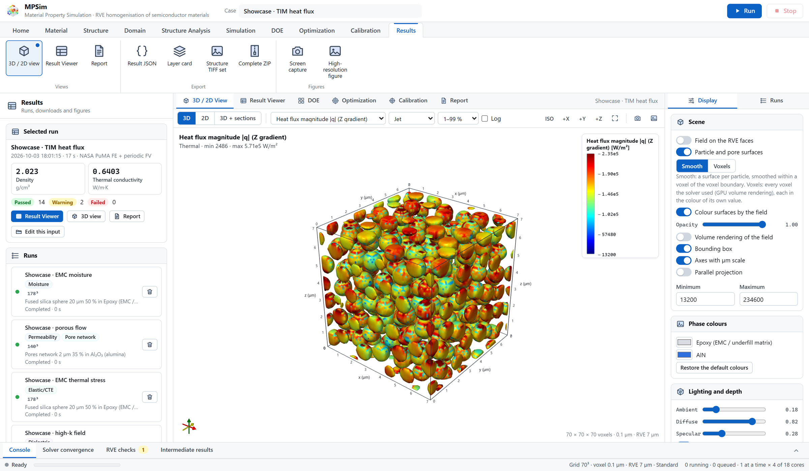
</p>

The ribbon follows the order of a study (Home, Material, Structure, Domain, Structure Analysis, Simulation, Results).
The command panel on the left holds the inputs of the active tab, the centre shows the 3D/2D view, the Result Viewer
or the report, and the inspector on the right controls the display and lists every run of the workspace: a click shows a
run in every view, a stopped run starts again from its row, and run folders or run ZIPs from another PC open into the
list. The dock below holds the console and a terminal that shows whether a long run's processes are working. Chapter 3
of the user guide describes the workspace in detail; chapter 33 is a tutorial for every example preset.

## Analyses

| Group | Analysis | Solver | Main results |
|---|---|---|---|
| Conduction | Thermal conductivity | Periodic FV (default), NASA PuMA FE | k tensor, directional k(n), diffusivity, area-specific resistance, bounds and mean-field models |
| | Electrical conductivity | same | σ tensor, resistivity, sheet resistance, percolation |
| Electromagnetics | Permittivity and loss | same | Dk tensor, Df, local field enhancement per region |
| | Magnetic permeability | same | μr tensor |
| | EMI shielding | Complex homogenisation → scikit-rf; openEMS FDTD check | SE(f) with reflection, absorption and multiple-reflection terms, validity limits |
| Mechanics | Elasticity and thermal expansion | FANS voxel FE (default), NASA PuMA FE | C\*, S\*, E, G, ν, Hill moduli, anisotropy index, α tensor, thermal stress per region; optionally α2 and E above Tg |
| | Mechanical test (tension or compression) | Effective stiffness + one FANS solve at the test load | Force-displacement line, apparent modulus, Poisson's ratio or lateral stress, von Mises and axial stress and strain fields, load at the matrix strength |
| Multiphysics | Thermal stress and warpage (thin film) | Film FV heat flow → FANS voxel FE with a thermal eigenstrain per voxel → laminate theory | Temperature field, curvature and warpage, in-plane stress through the film, largest principal and peeling stress per region, substrate stress |
| | Joule heating (thin film) | Film FV potential and heat solved in turn with σ(T) | Voltage, peak and face temperatures per step, runaway estimate, current-density and Joule-heat fields |
| | Cure during the compression | Kamal–Sourour + Castro–Macosko in the 3D compression | Conversion, viscosity, stress and temperature against time, gel stop |
| Rheology | Viscosity and flowability | FANS creeping flow; particle dynamics (lubrication DEM); Krieger–Dougherty with Farr–Groot φm | Relative viscosity, flow curve, φm, underfill filling time, settling, local shear-rate field |
| Reliability | Moisture uptake and swelling | Periodic FV on the water activity; FANS eigenstrain | D_eff tensor, saturated uptake, uptake curve, swelling strain and CME |
| Porous media | Permeability | NASA PuMA Stokes FE | K tensor, Kozeny–Carman constant, hydraulic tortuosity |
| | Filtration efficiency | Particle tracking in the Stokes field | Efficiency per particle size, most penetrating size, quality factor |
| | Diffusion and tortuosity | NASA PuMA | τ, D_eff/D₀, formation factor, MacMullin number, Knudsen and Bosanquet diffusivities |
| | Acoustic absorption | JCA model from the computed fields | Absorption, surface impedance, octave bands, NRC |
| Radiation | Radiative extinction | NASA PuMA ray casting | Extinction coefficient, Rosseland k_rad(T) |
| Structure | Porosity and size distributions | PoreSpy, NASA PuMA | Open/closed porosity, local thickness, chords, two-point correlation |
| | Porosimetry | PoreSpy | Intrusion/extrusion curves, bubble points |
| | Pore network | PoreSpy SNOW2 | Pores, throats, coordination numbers |
| | Percolation paths | Connected components, geodesic distance | Spanning fractions, geodesic tortuosity, largest passing sphere |
| | Grain analysis | Particle list, PoreSpy, PuMA structure tensor | Size distribution, sphericity, orientation tensor, spacing, clusters |
| Inverse problems | Calibration | RVE surrogate (Gaussian process), Bayesian posterior | Unknown material values with credible intervals, identifiability, next measurement |

Each result states the method that produced it. Conduction and thermal-expansion results are compared with rigorous
bounds (Wiener, Hashin–Shtrikman, Schapery); a value outside a rigorous bound is reported as a failed check.

## Application example: a mould underfill from flow to cure

This example follows one compound through the analyses that are relevant for a moulded underfill (MUF): epoxy filled
with fused silica of 15 µm and 3 µm at 55 vol% (38.5 vol% and 16.5 vol%). The viscosity of the uncured compound is
computed by particle dynamics. The same particle dynamics then shears a random packing of the compound in the resin,
and the arrangement it leaves is taken as the cured microstructure. Thermal conductivity, thermal expansion, stiffness,
permittivity, dielectric loss and moisture uptake are solved on this one structure (60 µm RVE, 240³ voxels). All
results below were obtained with the presets *MUF · epoxy + silica 15 + 3 µm 55 vol%* and *MUF · from flow to the cured
part* on a 14-core laptop without a GPU, with the particles touching where they meet (*Gap between particles* 0, the
default).

<p align="center">
  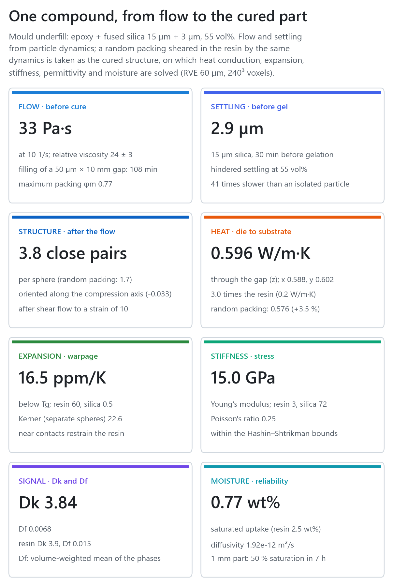
</p>

### Viscosity of the uncured compound

The particle dynamics resolves the lubrication forces between neighbouring particles, frictional contacts and van der
Waals attraction; every particle translates and rotates freely in a periodic box sheared by Lees-Edwards boundaries.
The relative viscosity is computed from the stress carried by the particles. In the animation, 2,222 particles are
coloured by their velocity relative to the imposed shear flow; red particles move fastest against their neighbours.

<p align="center">
  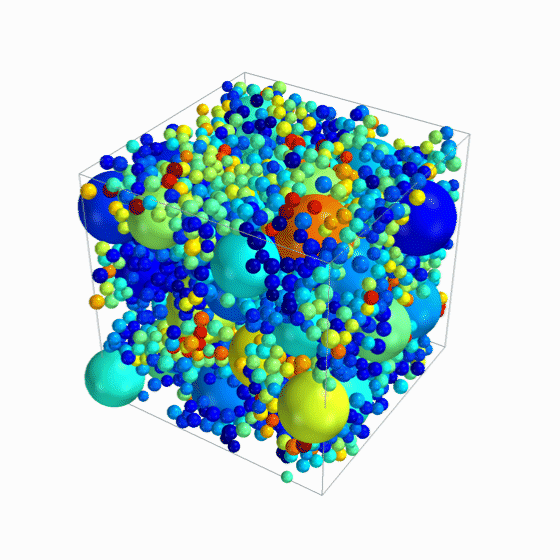
</p>
<p align="center">
  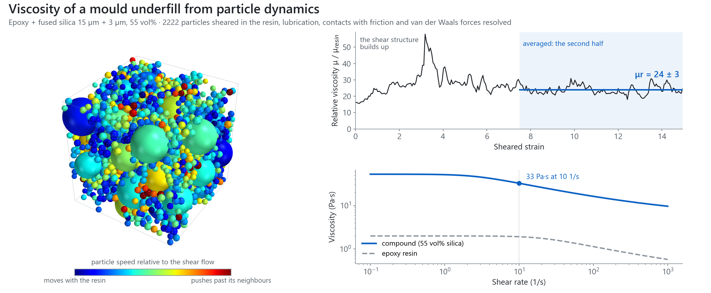
</p>

The relative viscosity overshoots while the shear microstructure forms and reaches a steady value from a strain of
about 6. The value is averaged over the second half of the run (a strain of 10 by default): μr = 24 ± 3, where the
uncertainty is the expected scatter between runs from independent packings. With the shear-thinning (Carreau) resin
the compound reaches 33 Pa·s at 10 s⁻¹. Derived results:

| Quantity | Value |
|---|---|
| Maximum packing fraction φm (Farr–Groot, actual size distribution) | 0.77 |
| Capillary filling of a 50 µm × 10 mm gap (Washburn, parallel plates, contact angle 30°) | 108 min (resin alone: 6.3 min) |
| Settling of the 15 µm silica in 30 min before gelation (hindered) | 2.9 µm, 41 times slower than an isolated particle |

### Microstructure after shear flow

*Domain → Particle arrangement → After shear flow* shears the random packing with the particle dynamics above, with
the flow along x and the velocity gradient along z, to a whole-number strain (10), at which the sheared periodic images
coincide with the ordinary ones. The spheres are sheared at the size they are drawn with, so that the final positions
need corrections of a few nanometres only (6 nm on average here).

<p align="center">
  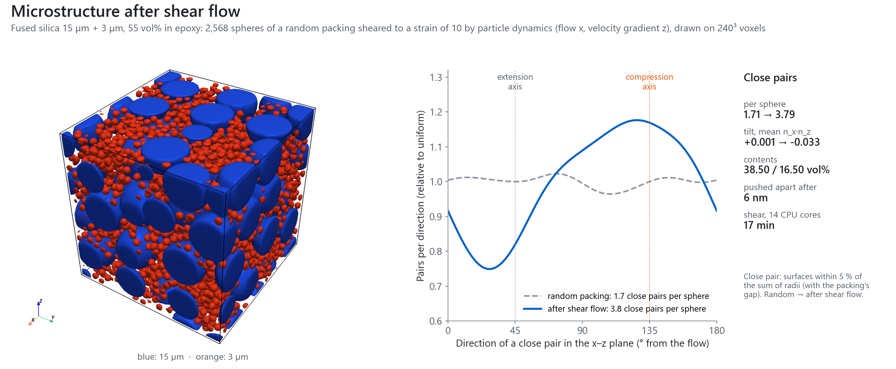
</p>

The number of close pairs (surfaces within 5 % of the sum of the radii) increases from 1.7 to 3.8 per sphere. The
pairs orient along the compression axis of the shear (135° from the flow direction in the x-z plane) and are depleted
along the extension axis (45°); the mean of n_x·n_z changes from +0.001 to -0.033. This anisotropic pair distribution
is characteristic of sheared non-Brownian suspensions (J. F. Morris, *Rheologica Acta* **48** (8), 909–923 (2009),
[doi:10.1007/s00397-009-0352-1](https://doi.org/10.1007/s00397-009-0352-1)). The filler contents of the drawn structure
are 38.50 and 16.50 vol%, equal to the input. The shear of 2,568 spheres to a strain of 10 took 17 minutes on 14 CPU
cores; on an NVIDIA GPU it takes minutes.

### Thermal conductivity

Steady heat conduction is solved on the cured RVE with periodic finite volumes for a temperature difference along x,
y and z. The animation shows the magnitude of the heat flux for heat driven along z, from the die side to the
substrate side of the gap; a cut plane travels through the RVE.

<p align="center">
  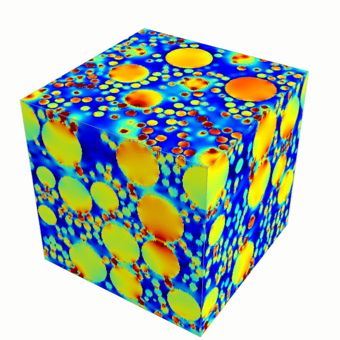
</p>
<p align="center">
  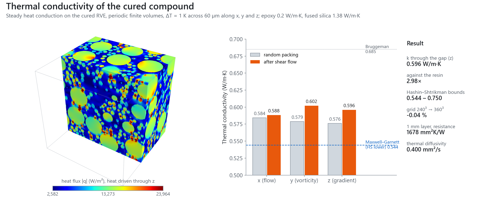
</p>

| Direction | Random packing (W/m·K) | After shear flow (W/m·K) | Change |
|---|---|---|---|
| x (flow) | 0.584 | 0.588 | +0.7 % |
| y (vorticity) | 0.579 | 0.602 | +4.0 % |
| z (velocity gradient, through the gap) | 0.576 | 0.596 | +3.5 % |

The conductivity through the gap is 0.596 W/m·K, 3.0 times that of the resin. It lies 9.5 % above the Maxwell-Garnett
estimate, which coincides with the lower Hashin–Shtrikman bound (0.544), and well below the Bruggeman estimate (0.685):
at a conductivity ratio of 7 between silica and epoxy, the points where particles touch carry little of the heat, and
the composite remains close to a dispersion of particles. The heat flux is highest in the silica and where particles
touch. The shear raises the conductivity by 3.5 % through the gap and 4.0 % along y, against 0.7 % along the flow: it
brings particles into contact (the touching voxel pairs increase from 108,279 to 377,147). These changes are of the order
of the statistical scatter of a single realisation (±4.3 % at 50 vol% for a 7-diameter RVE, and more for this
4-diameter RVE), so that several realisations would be needed to establish them. Refining the grid from 240³ to 360³
changes k_z by −0.04 %. A 1 mm layer has an area-specific thermal resistance of 1678 mm²K/W, and the thermal
diffusivity is 0.400 mm²/s.

### Thermal expansion and stiffness

The effective stiffness tensor and the thermal-expansion tensor are obtained with FANS from six unit strains and a
uniform temperature change. The render shows the von Mises stress for a temperature rise of 100 K with the RVE held at
its size.

<p align="center">
  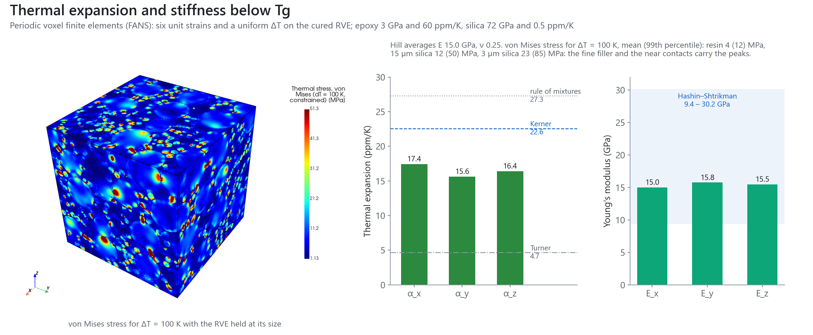
</p>

| Direction | α (ppm/K) | E (GPa) |
|---|---|---|
| x (flow) | 17.4 | 15.0 |
| y (vorticity) | 15.6 | 15.8 |
| z (velocity gradient) | 16.4 | 15.5 |

The volumetric mean CTE is 16.5 ppm/K, below the Kerner (Mori-Tanaka) estimate for separated spheres (22.6 ppm/K) and
above the Turner estimate (4.7 ppm/K); touching particles restrain the resin more than separated spheres do.
The Hill average of the Young's modulus is 15.0 GPa (Poisson's ratio 0.25), within the Hashin–Shtrikman bounds
(9.4–30.2 GPa); the shear moduli G_yz, G_xz and G_xy are 6.04, 5.71 and 5.91 GPa. The direction dependence is
consistent with the pair orientation: fewer close pairs lie along the flow direction x, where E is lowest and α
highest. Its magnitude (up to 11 % in α and 5 % in E) is comparable with the scatter of one realisation. The thermal
stress concentrates in the fine filler and where particles touch: the mean von Mises stress is 4 MPa in the resin
(99th percentile 12 MPa), 12 MPa in the 15 µm silica (50 MPa) and 23 MPa in the 3 µm silica (85 MPa). These local
stresses indicate where filler-matrix debonding is likely to start during temperature cycling.

Properties above the glass transition are not reported in this example: in the rubbery state the particles that touch
on the voxel grid form a rigid skeleton that the real compound, with resin films between the particles, does not have.
The same run gives α2 of 7.7–11.5 ppm/K, below α1, and a hot modulus of 3.1–3.8 GPa (user guide, section 14.5).

### Permittivity and dielectric loss

Permittivity and dielectric loss are obtained from a quasi-static complex conduction solution along x, y and z. The
render shows the local electric field relative to the applied field for a field along z.

<p align="center">
  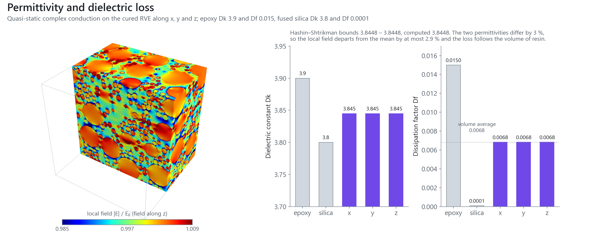
</p>

The dielectric constant is 3.845 in all three directions. The permittivities of silica (3.8) and epoxy (3.9) differ by
2.6 %, so that the Hashin–Shtrikman bounds coincide (3.8448) and the local field departs from the applied field by at
most 2.9 %. The dissipation factor is 0.0068, equal to the volume-weighted mean of the phases (0.45 × 0.015 + 0.55 ×
0.0001): fused silica leaves the dielectric constant unchanged and lowers the loss in proportion to the resin it
replaces.

### Moisture uptake and swelling

Moisture diffusion is solved on the water activity c/c_sat, which is continuous across the phase boundaries; the silica
does not absorb water. The uptake curve of a part follows from the effective diffusivity, and the swelling strain from
an eigenstrain solution with FANS.

<p align="center">
  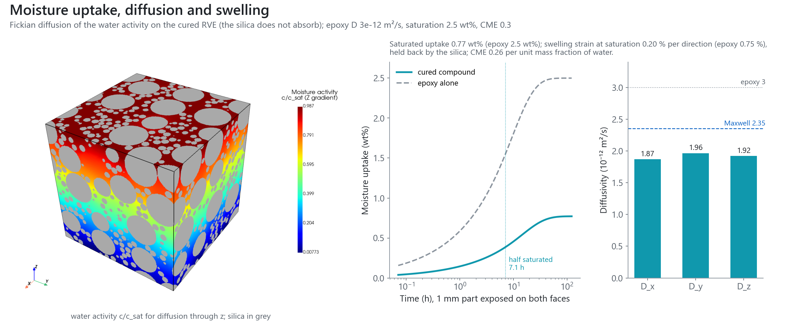
</p>

| Quantity | Cured compound | Epoxy |
|---|---|---|
| Saturated uptake | 0.77 wt% | 2.5 wt% |
| Diffusivity D_x / D_y / D_z (10⁻¹² m²/s) | 1.87 / 1.96 / 1.92 | 3.0 |
| 1 mm part, both faces exposed: 50 % / 95 % of saturation | 7.1 h / 41 h | 4.6 h / 26 h |
| Swelling strain at saturation (per direction) | 0.20 % | 0.75 % |

The saturated uptake equals the resin uptake scaled by the mass fraction of the resin. The effective diffusivity is
0.64 times that of the resin, 18 % below the Maxwell estimate for impermeable spheres (0.78), because at 55 vol% the
diffusion paths wind between closely spaced and touching particles. The silica restrains the hygroscopic swelling of the
resin to 0.20 %, which corresponds to a coefficient of moisture expansion of 0.26 per unit mass fraction of water.

## Application example: a filled resin against a porous one in a closed mould

Resin A (1 Pa·s) with 24 vol% air pores fills one half of a 30 µm RVE, resin B (2 Pa·s) with 40 vol% of 5 µm silica
spheres the other. *Domain → Particle arrangement → After compression* shortens the RVE by 10 % along z at 1/s with x and
y held (a closed mould), on 60³ voxels in four steps of the three-dimensional resin flow (7 minutes on 18 threads).

<p align="center">
  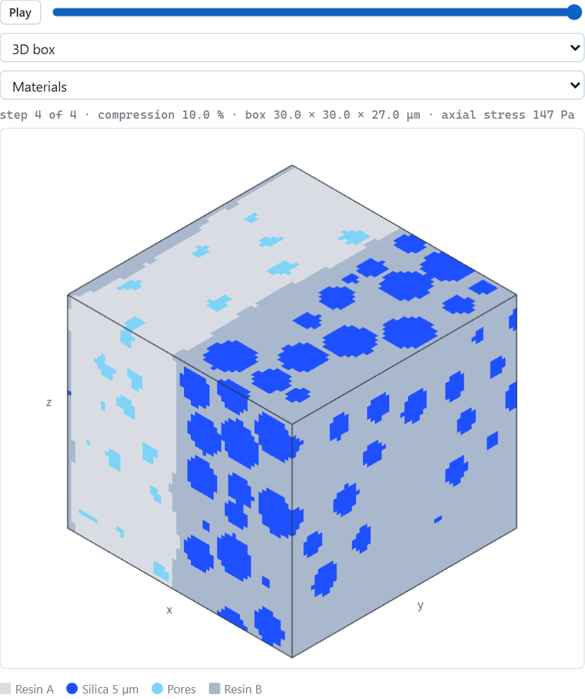
  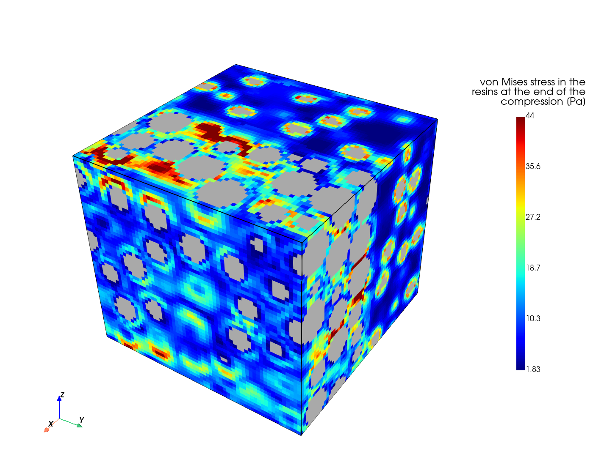
</p>

| Region | Share of the box | Strain z | Strain x | Strain y | von Mises in the resin |
|---|---|---|---|---|---|
| Resin A with its pores | 38.0 → 42.2 % | −3.7 % | −2.1 % | +5.1 % | 9.9 Pa |
| Resin B with the spheres | 30.0 → 32.8 % | −10.5 % | +8.3 % | +0.1 % | 16.5 Pa |

- The pores close from 12.0 to 2.7 vol% of the box and take the volume the mould removes; resin A keeps its volume.
- The filled resin advances into the porous one: resin B widens by 8.3 % across the interface while resin A narrows by
  2.1 %. The spheres move with their resin; none ends surrounded by resin A.
- The stress concentrates in the resin films between the spheres and around the closing pores; the axial stress rises
  from 66 to 147 Pa as the pores flatten. The compressed box conducts 0.331 W/m·K through z.

## Application examples: coupled analyses

Three presets show the coupled analyses of version 5.6.0; each was run as loaded on an 18-thread laptop.

### Thermal stress and warpage of a moulded underfill on a die

A 300 µm moulded underfill (8 µm silica, 50 vol%, in epoxy) on a 300 µm Si die, stress-free at the cure temperature of
175 °C, in operation with the die side at 125 °C and the top at 95 °C. The heat flowing through the film sets the
temperature of every voxel, the thermal strain of every voxel follows from it, and laminate theory releases the film
bonded to the die (70 × 70 × 375 voxels of 0.8 µm, 168 s).

<p align="center">
  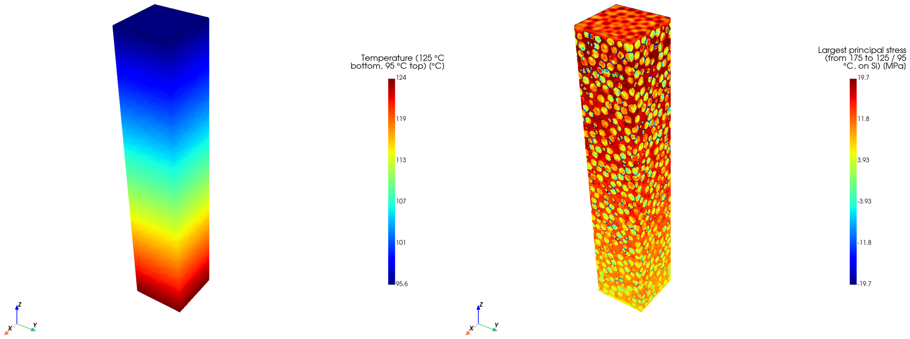
</p>
<p align="center">
  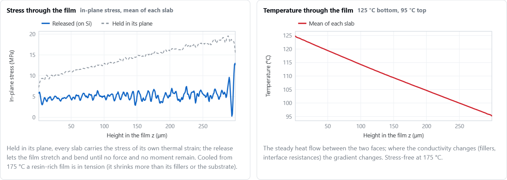
</p>

| Quantity | Value |
|---|---|
| Warpage over 10 mm (κ) | −12.89 µm (−1.03 1/m), edges up |
| The same film at its uniform mean temperature | −11.97 µm: the gradient adds −0.92 µm |
| Heat through the film, k_z | 51.4 kW/m², 0.514 W/m·K |
| Epoxy: largest principal / peeling stress (99.9 %) | 27.2 / 25.9 MPa |
| Silica: von Mises (99.9 %) | 160 MPa |
| Die: top / bottom face | −36.9 / +26.5 MPa |

Checks: a free film with a linear temperature bends without stress (κ −149.97 against αΔT/t = −150 1/m); a film on a
substrate bends as Timoshenko's bimetal (−20.002 against −19.994 1/m); a film held flat and cooled through its Tg carries
E/(1−ν)[α1(Tg − T) + α2(E_r/E)(T_ref − Tg)] exactly.

### Joule heating of an Ag-filled adhesive joint up to thermal runaway

A 25 µm joint of 5 µm silver spheres (45 vol%) in epoxy touching both electrodes, a current density stepped from 5·10⁷
to 3·10⁸ A/m², the joint's path to ambient 10⁻⁴ K·m²/W. The temperature coefficient of silver (0.0038 1/K) is taken
from the recommended resistivities of R. A. Matula, *J. Phys. Chem. Ref. Data* **8** (4), 1147–1298 (1979),
[doi:10.1063/1.555614](https://doi.org/10.1063/1.555614). 70 × 70 × 50 voxels of 0.5 µm, 81 s.

<p align="center">
  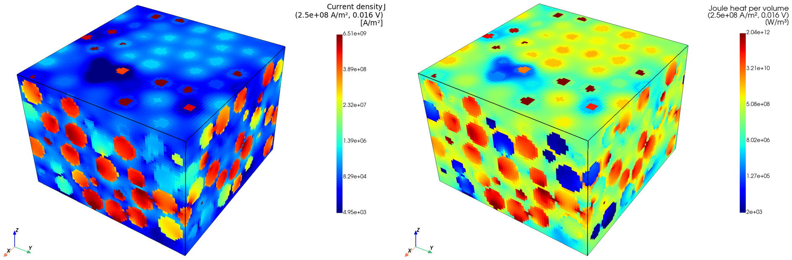
</p>
<p align="center">
  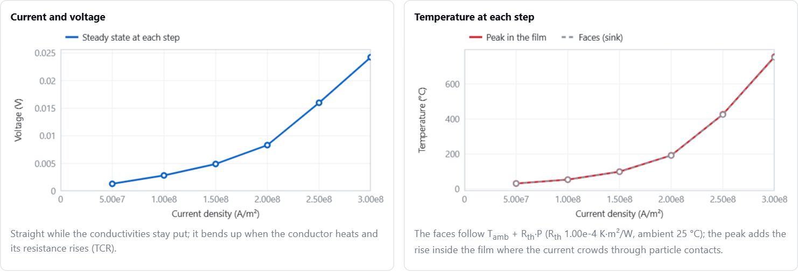
</p>

| J (A/m²) | V (mV) | σ through the joint (MS/m) | Faces / peak (°C) | State |
|---|---|---|---|---|
| 5·10⁷ | 1.32 | 0.95 | 31.6 / 31.6 | settled |
| 1·10⁸ | 2.84 | 0.88 | 53.4 / 53.5 | settled |
| 2·10⁸ | 8.33 | 0.60 | 191.5 / 192.2 | settled |
| 2.5·10⁸ | 16.0 | 0.39 | 424.8 / 426.5 | settled |
| 3·10⁸ | — | — | — | steady state above 1000 °C (1697 °C extrapolated) |

The path to ambient sets the temperature: inside the joint the current crowds through the particle contacts, but
silver conducts the heat away and the film adds only 1.7 K at 2.5·10⁸ A/m². As one resistor the joint has the
coefficient of silver and 25 µΩ·mm² at 20 °C, so a set current runs away above 1/√(TCR·R₂₀·R_th) = 3.2·10⁸ A/m².
Checks: the parabola of a uniform conductor exactly; with a TCR, a separate one-dimensional solve to 1.5·10⁻⁴ K; the
energy balance to 10⁻⁵.

### A moulded underfill that gels before the mould closes

Silica 5 µm (40 vol%) in epoxy pressed at 1 %/s towards 55 % in a mould at 175 °C while the resin cures. The kinetics
are those of an epoxy moulding compound fitted to DSC (E. Franieck, M. Fleischmann, O. Hölck, L. Kutuzova,
A. Kandelbauer, *Polymers* **13** (11), 1734 (2021), [doi:10.3390/polym13111734](https://doi.org/10.3390/polym13111734));
the Castro–Macosko constants of the viscosity rise were measured on a neat epoxy, not on a moulding compound
(S. K. Romberg, P. Roberts, C. R. Snyder, A. P. Kotula, *ACS Appl. Polym. Mater.* **6** (8), 4874–4884 (2024),
[doi:10.1021/acsapm.4c00607](https://doi.org/10.1021/acsapm.4c00607)). 70³ voxels of 0.5 µm, 20 steps, 230 s.

<p align="center">
  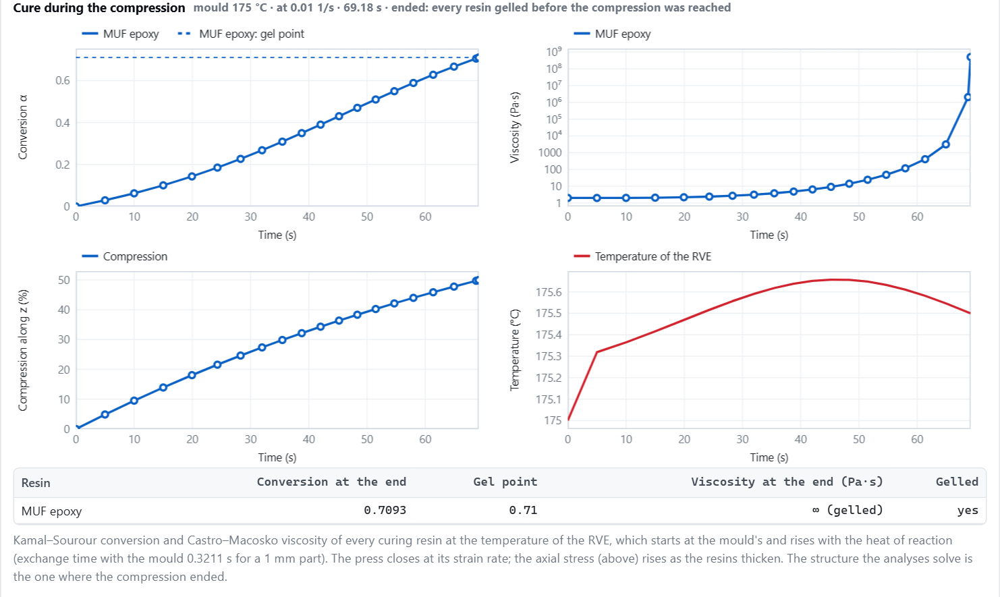
</p>

| Time (s) | Compression | Conversion α | Axial stress (Pa) |
|---|---|---|---|
| 0 | 0 % | 0 | 0.95 |
| 48 | 38.3 % | 0.47 | 14 |
| 58 | 44.0 % | 0.59 | 114 |
| 65 | 47.8 % | 0.67 | 2847 |
| 69.2 | 49.9 % | 0.709 (gel) | — |

The compound gels with the mould closed by 49.9 % of the 55 % asked; the temperature of the RVE stays within 0.66 K of
the mould (exchange time 0.32 s for a 1 mm part). Checks: n-th order kinetics against the closed form to 10⁻⁶; a resin
pressed at a constant stress creeps by ∫P/3η dt to the gel point (0.86747 against 0.86746).

## Verification

`5_SELF_TEST.bat` solves **87 problems with known solutions** (56 in the quick set) and compares the results with the
reference values. A selection:

| Check | Reference | Result |
|---|---|---|
| Series and parallel laminates (bulk and thin film) | 1.81818 / 5.5 | exact |
| Interfacial thermal resistance | Hasselman–Johnson | within 0.26 % |
| Simple cubic sphere array, extrapolated from 256³ | converged reference | 64³: FV +0.7 %, FE +4.0 % |
| Built-in periodic FV against PuMA's FV, same field on a three-phase grid | PuMA's operator | equal to 2e-16 |
| Multi-core PuMA Stokes flow and tortuosity | PuMA's single-threaded path | K within 4e-10, τ within 1e-15 |
| Threaded solves on one thread and on all | the same numbers | identical |
| Sections: a filler at 30 % of one half, a second matrix in that half | composition, no filler in the other half | exact |
| Two-phase thermal expansion | Levin's exact relation | relative error 5e-7 |
| Complex laminates (EMI homogenisation) | series/parallel closed form | error 1e-13 |
| Dilute spheres, complex admittivity | Maxwell-Garnett | within 0.06 % |
| Homogeneous slab in openEMS | exact slab transmission | within 0.001 dB |
| Cylindrical pore | Poiseuille; Λ = Λ′ = r | passed |
| Sobol indices of the Ishigami function | closed form | passed |
| FANS elasticity against PuMA (corrected) | same discretisation | 3.5e-9 |
| Dilute rigid sphere in a viscous liquid | Einstein [η] = 2.5 | within 15 % (voxelised sphere) |
| Particle dynamics, frictionless spheres at 50 vol% | Krieger–Dougherty with random close packing, 11.4 | 12.6 (200 spheres, strain 2) |
| Particle dynamics of cubes (rigid multi-sphere particles) | dissipated power = shear stress × rate | within 0.1 % |
| Anisotropic conduction: rotated tensor; tilted anisotropic laminate | exact; laminate formula | 2e-15; 2.6 % at 16 cells per layer (first order) |
| Maximum packing of bidisperse spheres | Farr–Groot simulations, 27 cases | within 0.011 |
| Impermeable sphere, moisture diffusion | Maxwell 2/(2+φ) | within 2 % |
| Calibration of R_int and filler k from two particle sizes | known values 2e-7 m²K/W, 2.0 W/m·K | 2.0e-7, 2.01 |
| Calibration of a bound resin layer from a viscosity (particle dynamics) | known value 10 nm | 10.6 nm (95 % 8.8–12.5) |
| Blends: two sphere sizes at 55 vol%, cubes with flakes at 45 vol% | no voxel inside two particles | 0 shared voxels, none trimmed |
| Complete pipelines: filled RVE, thin film, porous RVE, viscosity with live results | all files, all analyses | passed |
| DOE: share of a filler at a fixed total content; fixed grid | 5–50 % of 55 vol%, 160³ on every case | passed |
| Linked inputs: one R_int for two grades of a filler (calibration) | known value 3e-8 m²K/W | 3.0e-8 linked (4.5e-8 when only one grade is calibrated) |
| Stop of a run during parallel solutions | all processes of the run end | within seconds |
| Arrangement after shear flow: silica 4 + 1.6 µm, 45 vol%, strain 2 | contents kept, periodic, pairs oriented by the flow | close pairs 3.7 → 5.5 per sphere, n_x·n_z +0.014 → -0.024 |
| Measured size distribution by channel; bounded normal and log-normal | channel shares; bounds | within 1 %; exact |
| Uneven dispersions: region, 3x gradient, clusters holding 45–50 % | all particles in the region; ratio; share | exact; 2.3–2.7; 42–47 % |
| Mechanical test: isotropic material, laminate under uniaxial stress | E, ν, constrained modulus; σ equal in both layers | exact; σzz −10 MPa in both layers |
| Compression of a resin alone, sides free and plane strain | Trouton: σzz = −3ηε̇ and −4ηε̇, von Mises 3 and 2√3 ηε̇ | exact to 4 digits |
| Compression with both sides held, a pore of 30.6 vol%, 20 % | pore content by the volume balance, 13.19 vol% | 13.16 vol%, resin volume within 0.04 % |
| Arrangement after compression: resin A against resin B with 40 vol% silica, 30 % | each resin keeps its share; spheres stay in their resin | shares kept; 0 of 48 spheres in the other resin |
| Acoustic mismatch across epoxy / alumina | detailed balance Γ₁₂/v₁² = Γ₂₁/v₂² | within 4e-5 |
| Calibration with touching particles, R_c = 2·R_int | known value 5e-9 m²K/W | 5.01e-9 (95 % 3.8–6.3e-9); R_int alone flagged as not reaching |
| Thermal stress of a film: linear temperature, bimetal, cooling through Tg | αΔT/t; Timoshenko; E/(1−ν)[α1(Tg−T) + α2(E_r/E)(T_ref−Tg)] | −149.97 vs −150 1/m; −20.002 vs −19.994 1/m; 34.8231 MPa exact |
| Joule heating: uniform conductor, with a TCR, two layers in series | parabola; 1D solve; L₁/σ₁ + L₂/σ₂ | exact; within 1.5e-4 K; within 1e-6 |
| Cure kinetics and creep at a constant stress up to the gel point | n-th order closed form; ∫P/3η dt | within 1e-6; 0.86747 vs 0.86746 |
| Conductor joining the two faces of a film | spans the film (not a periodic wrap) | recognised; kept conducting |
| Queue: structures side by side, solves through the memory gate | a light solve passes a heavy one only while the heavy one still fits | passed |
| A run stopped while it waits at the memory gate | the queue keeps answering (a killed waiter hangs a multiprocessing Event) | passed; the gate is a non-blocking flag |
| Stopped run started again; run folder copied elsewhere; run folder ZIP | its structure reused; listed after a server restart; imported with its 3D view | passed |
| Progressive overlap: equal spheres at 66 vol% (above random close packing) | content reached, overlap bounded by the voxels allowed | 65.95 % with ≤ 2 voxels (62.6 % without) |
| Statistical RVE: realisations until the 95 % interval is within the target | stops at the target or the most allowed; whole-number DOE seeds | passed |
| Every step of a compression kept in 3D, also for a reused structure | labels and stress of each step's whole box | passed |

Two presets also verify the solver against an exact solution. Copper vias that pass straight through a laminate conduct
heat as parallel paths, k_z = f·k_Cu + (1 − f)·k_laminate for a copper area fraction f. The presets *PCB thermal vias*
and *Glass core substrate · Cu TGVs* give 9.2851 and 36.0295 W/m·K, which agree with this value to the fourth decimal;
in version 5.2.3 this check revealed that thin films ignored the anisotropy of their laminate.

**Comparison with published measurements.** Four presets reproduce materials whose properties have been measured and
published. Each preset was run as loaded; the preset descriptions discuss the remaining differences.

| Preset | Reference | Reported | Computed |
|---|---|---|---|
| Heat spreader · Cu + diamond 50 vol% (400 µm) | Wang et al., *Materials* 2025 [1] | 640 W/m·K | 646 W/m·K, with 12.5 MW/m²K at the interface |
| Power-module baseplate · AlSiC 63 vol% | Guo et al., *J. USTB* 2014 [2] | 178 W/m·K, 8.21 ppm/K | 189 W/m·K, 8.84 ppm/K |
| mmWave substrate · PTFE + silica 60 wt% | Murali et al., *Compos. Part A* 2009 [3] | Dk 2.9 | Dk 3.01 |
| Power inductor · epoxy + carbonyl iron 54 vol% | Sugawa et al., *IEEE Trans. Magn.* 2013 [4] | μr 7.5 (printed) | μr 5.96 (spheres) |

1. Q. Wang, Z. Ye, L. Liu, J. Bai, Y. Zhao, Q. Hu, H. Liu, L. Hu, X. Guo, Y. Xiao, W. Cao, Z. Yang, “High thermal conductivity diamond–copper composites prepared via hot pressing with tungsten-coated interfacial layer optimization”, *Materials* **18** (16), 3882 (2025). [doi:10.3390/ma18163882](https://doi.org/10.3390/ma18163882) — 400 µm diamond, 50 vol%: 640 W/m·K.
2. M. Guo, J. Liu, C. Jia, S. Guo, Y. Li, H. Zhou, “Microstructure and properties of SiCp/Al electronic packaging materials fabricated by pseudo-semi-solid thixoforming”, *Journal of University of Science and Technology Beijing* **36** (4), 489–495 (2014). [doi:10.13374/j.issn1001-053x.2014.04.011](https://doi.org/10.13374/j.issn1001-053x.2014.04.011) — as tabulated in L. Lai et al., *Micromachines* **14** (8), 1491 (2023), Table 2, [doi:10.3390/mi14081491](https://doi.org/10.3390/mi14081491).
3. K. P. Murali, S. Rajesh, O. Prakash, A. R. Kulkarni, R. Ratheesh, “Preparation and properties of silica filled PTFE flexible laminates for microwave circuit applications”, *Composites Part A* **40** (8), 1179–1185 (2009). [doi:10.1016/j.compositesa.2009.05.007](https://doi.org/10.1016/j.compositesa.2009.05.007) — 60 wt% micron silica, X band.
4. Y. Sugawa, K. Ishidate, M. Sonehara, T. Sato, “Carbonyl-iron/epoxy composite magnetic core for planar power inductor used in package-level power grid”, *IEEE Transactions on Magnetics* **49** (7), 4172–4175 (2013). [doi:10.1109/TMAG.2013.2250925](https://doi.org/10.1109/TMAG.2013.2250925) — screen-printed 54 vol% core.

**RVE size.** The 7× and 10× criteria were determined from repeated runs on independent random structures, evaluated
with the statistical method of Kanit et al. (2003). The random scatter of one realisation (95 % interval) was ±0.12 % /
±0.14 % for the conductivity of 30 vol% fillers, ±4.3 % / ±1.9 % at 50 vol%, and ±0.92 % / ±0.38 % for the Young's
modulus at 30 vol% (7× / 10×). The size bias was within the scatter from 5× onwards.

<p align="center">
  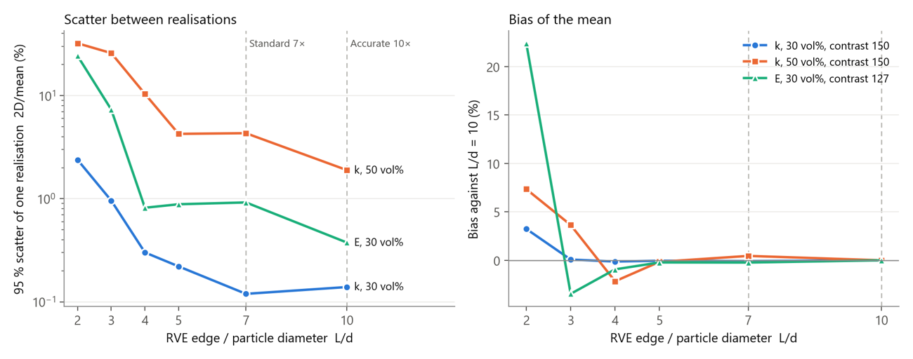
</p>

Every run also reports its own checks (RVE size, resolution, particle count, convergence, bounds) as passed, warning or
failed, together with the reason. Chapter 31 of the user guide explains these checks.

## Documentation

| User guide | PDF |
|---|---|
| English, 188 pages | [MPSim-User-Guide-EN.pdf](https://github.com/HyoseokByun-opt/MPSim/releases/latest/download/MPSim-User-Guide-EN.pdf) |
| Korean, 176 pages | [MPSim-User-Guide-KO.pdf](https://github.com/HyoseokByun-opt/MPSim/releases/latest/download/MPSim-User-Guide-KO.pdf) |

Each simulation chapter describes how the property is measured in the laboratory, how MPSim computes it, how the
numbers and renderings are read, and the underlying assumptions; chapter 32 treats two semiconductor-material problems
from start to finish. The guides are attached to every [release](https://github.com/HyoseokByun-opt/MPSim/releases)
(the links above always open the latest version) and are included, together with an HTML version, in the offline
package.

## System requirements

| | Minimum | Recommended |
|---|---|---|
| Operating system | Windows 10 or 11, 64-bit | Windows 11 |
| CPU | 4 cores | 16 or more cores (solvers and independent solutions run in parallel) |
| Memory | 16 GB (grids up to about 240³ for conduction and elasticity) | 64 GB or more; 512 GB runs 500³ elasticity |
| Disk | 2 GB for the installation, plus the runs | SSD |
| GPU | not required | NVIDIA GPU with CUDA for the particle dynamics |
| Browser | Chrome or Edge (WebGL 2) | same |

The RVE grid limit is 500³ by default and can be changed per server. The planner estimates the peak memory of each
solver before the run and warns with the estimate instead of refusing. Estimates per voxel: conduction about 230 bytes
(500³ ≈ 29 GB); elasticity about 300 bytes with FANS, the default (240³ measured at 3 GB, 500³ ≈ 38 GB) and 2.5 kB
with PuMA FE; Stokes flow about 2.3 kB.

## Installation

The program is distributed in two forms:

- **The source (this repository)**, installed with conda on a PC with internet access.
- **The offline package**, the same program with the official Python runtime, all 78 wheels and openEMS (about
  500 MB), for PCs without internet access. Binaries are not kept in the repository; the package is available on the
  [**Releases**](https://github.com/HyoseokByun-opt/MPSim/releases) page or can be built with `tools\build_offline.py`
  (see below).

### With conda (from the source)

On a PC with internet access and Miniconda or Anaconda:

```bat
git clone https://github.com/HyoseokByun-opt/MPSim.git C:\MPSim
cd C:\MPSim
1_INSTALL.bat
```

`1_INSTALL.bat` creates a private environment in `env\` from `environment.yml` (conda-forge), downloads openEMS into
`tools\openEMS` for the EMI full-wave simulation and runs the quick self-test; the equivalent manual command is
`conda env create -p .\env -f environment.yml`. The program is started with `2_RUN_LOCAL.bat`. A short installation
path such as `C:\MPSim` is recommended (see [Common errors](#common-errors)).

NASA PuMA is distributed on conda-forge as the package `puma`. The PyPI project `pumapy` is an unrelated package and
must not be installed.

### On an offline PC

The offline package contains the official Python 3.11.9 runtime from python.org, 78 wheels (320 MB) including NASA
PuMA, and openEMS. Neither internet access nor conda is required.

1. Copy the folder to the offline PC, preferably to a short path such as `C:\MPSim`.
2. Run **`1_INSTALL_OFFLINE.bat`**. It unpacks the runtime into `python\`, installs the wheels with pinned versions,
   unpacks openEMS into `tools\openEMS`, checks every import and runs the quick self-test. Nothing outside the folder
   is changed (no registry entries, no PATH changes).
3. Start the program with `2_RUN_LOCAL.bat`.

The program is removed by deleting the folder.

### Building the offline package

On a PC with internet access and the tested conda environment (`environment.yml`):

```bat
conda run -p .\env python tools\build_offline.py            :: runtime, openEMS, PuMA wheel, 78 wheels
conda run -p .\env python tools\build_offline.py --no-openems
```

PuMA is packed from the conda-forge build into a standard wheel. Its compiled modules import only `python311.dll`,
`VCRUNTIME140.dll` and the Windows C runtime, so that the same files work in any CPython 3.11 on 64-bit Windows. The
versions are pinned in `requirements-offline.txt` and `constraints-offline.txt`: PuMA 3.2.2 requires numpy < 2 and
scipy 1.11, and vtk 9.5.2 is pinned together with pyvista 0.47.1.

## Running

| File | Purpose |
|---|---|
| `2_RUN_LOCAL.bat` | This PC only; opens `http://127.0.0.1:8000` in the browser |
| `3_RUN_SERVER.bat` | Serves the local network at `http://SERVER-IP:8000`; `--token auto` adds a shared access token |
| `4_NETWORK_CHECK.bat` | Reports why other PCs cannot connect (changes nothing) |
| `5_SELF_TEST.bat` | Verifies the engine against known solutions (`--quick` for the short set) |
| `6_RUN_COMMANDLINE.bat` | Runs a preset without the browser, e.g. `--preset tim_aln --quality fast` |

Workflow in the browser: **Home** (preset) → **Material** → **Structure** (*Generate structure*) → **Domain**
(*Generate voxel grid*) → **Structure Analysis** and **Simulation** (select analyses) → **Run** →
**3D / 2D View**, **Result Viewer**, **Report**. **DOE**, **Optimization** and **Calibration** extend a single case to a
study.

Server options (`app\run_web.py`):

```text
--host 0.0.0.0            address to listen on (127.0.0.1 = this PC only)
--port 8000
--token auto              shared access token ("auto" generates one)
--workspace PATH          where runs are kept (default: workspace\)
--concurrency 1           jobs solved at the same time
--max-voxels 500          grid limit per edge for conduction; 0 = off
--max-voxels-elastic 500  for elasticity and thermal expansion
--max-voxels-flow 500     for Stokes flow
--check                   report why other machines may not connect, then exit
```

After an update, the browser page should be reloaded with **Ctrl+F5** so that the new scripts are loaded.

## Project layout

```text
1_INSTALL.bat, 1_INSTALL_OFFLINE.bat … 6_RUN_COMMANDLINE.bat, _common.bat
environment.yml, requirements-offline.txt, constraints-offline.txt
app/
  mpsim/                 engine, independent of the browser
    spec.py              input validation and label table
    rve.py               RVE criteria, automatic sizing, memory estimate
    shapes.py, geometry.py, generate.py      shapes, size distributions, RVE generation (numba)
    solvers/             conduction.py (periodic FV), fans.py and elastic.py (FANS mechanics),
                         viscosity.py (creeping flow), suspension.py (particle dynamics),
                         compress.py (compression of the RVE while its resin flows),
                         puma_backend.py (NASA PuMA), complex_cond.py and emi.py (EMI), fullwave.py (openEMS)
    morphology.py, poro.py, percolation.py, grains.py, filtration.py, acoustics.py, streamlines.py
    analytical.py        rigorous bounds and mean-field models
    doe.py, optimise.py, calibrate.py, links.py        studies, surrogate models, calibration, linked inputs
    visual.py, report.py viewer data, publication figures, HTML report
    pipeline.py          one run end to end
    data/                materials.json (68 materials), presets.json (31 presets)
  web/                   Flask server, job queue, workspace UI (vtk.js)
  run_web.py, run_cli.py, selftest.py
docs/images/             the README images (the user guides are attached to the releases)
tools/                   build_offline.py, check_imports.py, make_download.py
runtime/, wheels/        Python runtime, openEMS and wheels (offline package only, not in the repository)
workspace/               results, kept across restarts (created at the first start)
```

## Common errors

**`WinError 206` or "filename too long" during installation.** A few packages contain deep paths that exceed the
260-character limit of Windows. The folder should be moved to a short path such as `C:\MPSim`, or long paths enabled
(`LongPathsEnabled` = 1 under `HKLM\SYSTEM\CurrentControlSet\Control\FileSystem`; administrator rights are required).

**Other PCs cannot open the server.** In most cases the Windows firewall blocks the port or the network profile is
*Public*. `4_NETWORK_CHECK.bat` on the server lists the addresses and what blocks them. The connection is best tested
from another PC with `curl -m 5 http://SERVER-IP:8000/healthz` rather than with ping.

**`cannot import name 'vtkCapsuleSource'`** or a PuMA import error in a self-made environment. vtk ≥ 9.7 or numpy ≥ 2
was installed next to PuMA 3.2.2. Installing with `constraints-offline.txt` or `environment.yml` pins compatible
versions.

**A run stops with a memory warning.** The planner's estimate exceeds the free memory. The grid can be reduced (larger
voxel or smaller RVE), fewer analyses solved at once, or `--concurrency` lowered.

**The page looks outdated after an update.** The browser keeps the old scripts; reload with Ctrl+F5.

**The full-wave EMI check reports "openEMS not found".** openEMS is searched in `tools\openEMS`, the `MPSIM_OPENEMS`
environment variable, `C:\openEMS` and the PATH. The offline installer unpacks it into `tools\openEMS`.

Further cases are listed in appendix D of the user guide.

## Citing

Published work that uses MPSim should cite the software (GitHub shows the citation under **Cite this repository**,
from [CITATION.cff](CITATION.cff)):

> H. Byun, *MPSim: Material Property Simulation*, version 5.6.1, Zenodo (2026). https://doi.org/10.5281/zenodo.23120194

The DOI 10.5281/zenodo.23120194 always resolves to the latest version; each release also has its own DOI on Zenodo.

The solvers that produced the results should be cited as well:

- J. C. Ferguson, F. Panerai, A. Borner, N. N. Mansour, "PuMA: the Porous Microstructure Analysis software",
  *SoftwareX* 7, 81–87 (2018).
- J. C. Ferguson, F. Semeraro, J. M. Thornton, F. Panerai, A. Borner, N. N. Mansour, "Update 3.0 to PuMA: the Porous
  Microstructure Analysis software", *SoftwareX* 15, 100775 (2021).
- J. T. Gostick et al., "PoreSpy: A Python toolkit for quantitative analysis of porous media images", *Journal of
  Open Source Software* 4(37), 1296 (2019).
- T. Liebig, A. Rennings, S. Held, D. Erni, "openEMS – a free and open source equivalent-circuit (EC) FDTD
  simulation platform supporting cylindrical coordinates suitable for the analysis of traveling wave MRI
  applications", *International Journal of Numerical Modelling* 26(6), 680–696 (2013).
- A. Arsenovic et al., "scikit-rf: An open source Python package for microwave network creation, analysis, and
  calibration", *IEEE Microwave Magazine* 23(1), 98–105 (2022).
- R. Mari, R. Seto, J. F. Morris, M. M. Denn, "Shear thickening, frictionless and frictional rheologies in
  non-Brownian suspensions", *Journal of Rheology* 58(6), 1693–1724 (2014).
- F. Boyer, É. Guazzelli, O. Pouliquen, "Unifying suspension and granular rheology", *Physical Review Letters* 107,
  188301 (2011).
- Y. Hu, T.-M. Li, L. Anderson, J. Ragan-Kelley, F. Durand, "Taichi: a language for high-performance computation on
  spatially sparse data structures", *ACM Transactions on Graphics* 38(6), 201 (2019).
- T. Kanit, S. Forest, I. Galliet, V. Mounoury, D. Jeulin, "Determination of the size of the representative volume
  element for random composites: statistical and numerical approach", *International Journal of Solids and
  Structures* 40(13–14), 3647–3679 (2003) (the RVE size criteria).

## Contributing and bug reports

Bug reports and suggestions are welcome as GitHub issues. A report should include the run folder, or at least its
`spec.normalized.json`, `result.json` and the console log (**Results → Complete ZIP** collects all of them), the version
shown in the title bar and the output of `5_SELF_TEST.bat --quick`. Pull requests should keep the self-test passing and
add a check for any new solver or analysis.

## Authors

**Hyoseok Byun** ([GitHub](https://github.com/HyoseokByun-opt) · [LinkedIn](https://www.linkedin.com/in/hyoseok-byun-72992120a)): concept, design, direction and
validation.

**Declaration of AI assistance.** The code, the verification tests and the user guides were written with the assistance
of Claude (Anthropic; Claude Code with Claude Opus 5.5), an AI assistant, working under the author's direction. The
author reviewed and edited the output and takes full responsibility for the content. Following the practice of
scientific publishing, the AI assistant is acknowledged here rather than listed as an author; commits written with its
help carry a `Co-Authored-By: Claude` trailer.

MPSim builds on the open-source projects listed under [License](#license); their authors deserve the credit for the
solvers.

## License

The code and documentation of MPSim are released under the MIT License (see [LICENSE](LICENSE)). Redistributions must
keep the copyright notice and the licence text.

The program builds on the open-source projects below. They are installed from conda-forge or PyPI; only vtk.js and
gifenc are included in the repository (`app/web/static/vendor`, with their licences). The offline package
redistributes them unchanged, each under its own licence:

| Component | Licence | Use |
|---|---|---|
| NASA PuMA 3.2.2 | NASA Open Source Agreement 1.3 (licence included in the wheel) | FE conduction, elasticity, Stokes flow, tortuosity, ray casting |
| openEMS v0.37.0-rc3 | GPL-3.0 (CSXCAD LGPL-3.0), run as a separate program; source at [thliebig/openEMS-Project](https://github.com/thliebig/openEMS-Project) | EMI full-wave check |
| PoreSpy, OpenPNM | MIT | Morphology, porosimetry, pore network |
| Taichi | Apache-2.0 | Particle dynamics of the viscosity (CPU or CUDA GPU) |
| scikit-rf | BSD-3-Clause | EMI transmission line |
| VTK / PyVista | BSD-3-Clause / MIT | Surfaces, figures |
| vtk.js | BSD-3-Clause | 3D view in the browser |
| gifenc | MIT | Animated GIFs of the views, in the browser |
| NumPy, SciPy, numba, scikit-image, scikit-learn, pandas, Flask, psutil, tifffile, pyamg | BSD or MIT | Numerics, server |
| Matplotlib | Matplotlib licence (PSF-based) | Figures |
| Python 3.11.9 | PSF License | Runtime |
